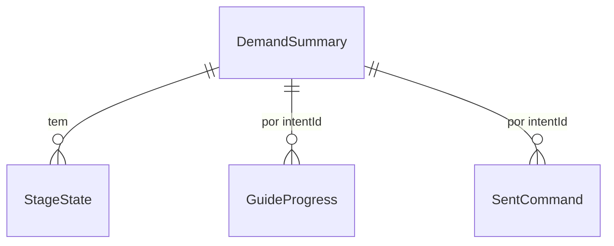

# Especificação funcional: u1-walking-skeleton

**Histórias (`inception/user-stories/stories.md`):** US1.1 (parte de base), US1.3, US3.1, US3.2, US3.3 e US3.4.

Base: `inception/units-generation/unit-of-work.md`, `inception/requirements-analysis/requirements.md`, `inception/domain-design/components.md`, `inception/contract-design/contract-summary.md`, `entities.md` e `rules.md`.

## O que esta Unidade prova

1. `npm run dev` abre o painel em `127.0.0.1`.
2. O terminal real abre no Git Bash, ocupa a lateral direita e mantém a sessão ao recarregar.
3. O painel lê o intent ativo e mostra a etapa e o passo, a partir dos arquivos do AI-DLC.
4. O comando só vai ao terminal depois da confirmação.

## Fluxos

### W1. Abrir o painel

1. O processo inicia e valida a configuração (BR1.3, BR1.6).
2. Ele localiza a raiz do repositório (BR1.4), cria `.vibes/` se faltar (BR1.5) e aplica as migrações (BR6.1).
3. O servidor escuta no endereço configurado (BR1.1). Fora de `127.0.0.1`, registra o aviso (BR1.2).
4. A pessoa abre o painel, que busca a decisão atual da demanda ativa.
5. Sem `aidlc/` ou com o registro ativo ilegível, a tela mostra uma mensagem simples com o que aconteceu e o caminho. A tela completa vem em U5.

### W2. Terminal

1. O painel pede a sessão antes da decisão, informando o `sessionId` guardado na aba, se houver.
   - Com uma sessão viva, a aba entra nela.
   - Sem registro no servidor e sem `sessionId`, o servidor abre uma (BR3.1).
   - Sem registro no servidor e com um `sessionId` antigo, o servidor cria um registro `dead`, com `endReason` igual a `server_stopped`, e não abre o shell (BR3.7).
   - Com um registro `dead`, nada abre sozinho (BR3.6).
2. Sem Git Bash, a sessão fica `unavailable`, `repo.health` vira `missing_shell`, e a mensagem mostra o caminho procurado (BR3.2).
3. A pessoa digita, e a entrada vai ao shell. A saída volta a todas as abas, em blocos numerados por `seq` (BR3.5).
4. Ao recarregar, a tela vazia recebe todos os blocos guardados. Se o stream cair sem recarregar, o painel informa `afterSeq` e recebe só o que falta (BR3.3, BR3.4).
5. Recolher e expandir só mudam a tela (BR3.3).
6. Encerrar a sessão pede confirmação na própria linha, nomeando o efeito. Depois, o registro fica `dead`, com `endReason` igual a `killed`. Se o shell acabar sozinho, fica `dead` com `shell_exited` (BR3.6).
7. Em qualquer `dead`, o guia oferece Nova sessão, que substitui o registro e abre o shell (BR3.1).

### W3. Ver a etapa e entender

1. O servidor lê os cursores, `aidlc-state.md` e o grafo de etapas, e monta o retrato de sinais (BR4.2, BR4.3).
2. O `Core` devolve a decisão (BR4.1).
3. A tela mostra a trilha mínima da etapa atual, de quem é a vez, a instrução e no máximo uma ação (BR4.4).
4. Em Entender, a pessoa lê o que a etapa faz (BR4.6) e clica em Entendi, continuar. O servidor grava `understoodAt`.

### W4. Enviar o comando

1. O guia mostra `/aidlc`, o nome da etapa ao lado, o campo editável e o lembrete (BR5.6, BR5.8).
2. A pessoa pode editar. Quebras de linha são recusadas, com o motivo (BR5.5).
3. A pessoa clica em Enviar agora ou Colar sem executar (BR5.1). A interface gera o `commandId` e desativa os botões.
4. A rota checa a origem (BR2.1), o formato (BR5.5) e o `commandId` (BR5.3).
5. A rota relê a demanda ativa e pede a decisão ao `Core` (BR5.7). Se a tela estiver desatualizada, responde 409 `stale_screen`, e a interface pede a decisão de novo. Se `canSend` for falso, responde 409 com o motivo.
6. A rota grava `pending`, escreve no terminal e grava `written` com `writtenAt` (BR5.2). Com falha, grava `failed` e responde 500, e o texto continua no campo.
7. O terminal recolhido reabre, sem mover o foco (BR3.11). O foco vai à instrução do momento seguinte.
8. No modo colar, o guia pede para pressionar Enter (BR5.4).

### W5. Acompanhar

1. O observador avisa que algo mudou em `aidlc/`, em até 3 segundos, e a interface pede a decisão de novo (BR4.7).
2. Com um comando executado e a etapa em `pending`, `[-]` ou em revisão, o momento é `following`, a vez é da IA, e a tela mostra "Se a sua IA perguntar algo, responda no terminal".
3. Com a etapa em `[?]`, a vez é da pessoa, e a tela mostra "Confira o terminal: a sua IA pode estar esperando por você". Com `[x]`, etapa pulada ou marca desconhecida, a tela mostra o mesmo texto, sem afirmar aprovação. Os momentos próprios vêm em U2.

## Máquinas de estado

### Sessão do terminal

| Estado | Evento | Condição | Próximo |
|---|---|---|---|
| (sem registro) | Pedido sem `sessionId` | Shell encontrado | `alive` |
| (sem registro) | Pedido sem `sessionId` | Sem shell | `unavailable` |
| (sem registro) | Pedido com `sessionId` antigo | | `dead`, com `server_stopped` |
| `alive` | Encerrar | | `dead`, com `killed` |
| `alive` | Shell terminou | | `dead`, com `shell_exited` |
| `alive` | Servidor parou | | (sem registro) |
| `dead` | Nova sessão | Shell encontrado | `alive`, com novo `sessionId` |
| `dead` | Nova sessão | Sem shell | `unavailable` |
| `unavailable` | Tentar de novo | Shell encontrado | `alive` |

Sem registro, o retrato de sinais lê `dead`. Isso só ocorre antes do primeiro pedido de sessão, que a página faz antes de pedir a decisão.

### Comando enviado

| Estado | Evento | Próximo |
|---|---|---|
| (nenhum) | Confirmação | `pending` |
| `pending` | Escrita concluída | `written` |
| `pending` | Escrita falhou | `failed` |
| `pending` | Processo reiniciou antes de concluir | `failed`, no início seguinte |

`written` e `failed` são finais. Um novo envio usa um novo `commandId`.

### Momentos em U1

A primeira condição verdadeira vale. As condições usam campos do retrato de sinais.

| Ordem | Condição | Momento | Vez de | Ação |
|---|---|---|---|---|
| 1 | `repo.health` diferente de `ok` | `failure` | Pessoa | `retry` |
| 2 | `session.status` igual a `dead` | `session_dead` | Pessoa | `new_session` |
| 3 | `stage.mark` em `approved`, `skipped` ou `unknown` | `following` | Pessoa | `none` |
| 4 | `guide.commandSent` igual a `executed` e `stage.mark` igual a `awaiting_approval` | `following` | Pessoa | `none` |
| 5 | `guide.commandSent` igual a `executed` | `following` | IA | `none` |
| 6 | `guide.commandSent` igual a `pasted` | `pasted` | Pessoa | `none` |
| 7 | `guide.understood` verdadeiro | `send` | Pessoa | `send` |
| 8 | Demais casos | `understand` | Pessoa | `understood` |

**Como `guide.commandSent` é calculado.** Ao montar o retrato, olha-se o último comando `written` da etapa:

- sem comando, `none`;
- `execute`, `executed`;
- `paste`, `pasted`, até a data de modificação de `aidlc-state.md` ser maior que `writtenAt`. A partir daí, `executed`.

As duas datas vêm do relógio da mesma máquina, em milissegundos. O produto não escreve em `aidlc/`, então a mudança vem da CLI ou de outra pessoa. Por isso, o texto não afirma que o comando colado foi o motivo.

`canSend` é verdadeiro só no momento `send`, com `repo.health` igual a `ok`, a demanda ativa, a sessão `alive` e `cliKind` igual a `claude_code`.

## Saída do foco no terminal

F6 alterna o foco entre o guia e o terminal, e é capturada antes de chegar à CLI (BR3.10). A barra do terminal mostra um botão Voltar ao guia e informa o atalho. Isso resolve o conflito com Shift+Tab, que a CLI pode usar. F6 também é atalho do navegador, então a página impede esse efeito, e a prova confere. Se um navegador não permitir, o botão continua alcançável pelo teclado.

## Casos de borda

| Caso | Comportamento |
|---|---|
| `aidlc-state.md` sendo gravado | Mantém a última leitura válida e lê de novo na próxima mudança |
| Marca desconhecida | `following`, sem afirmar aprovação (BR4.1) |
| Sem intent ativo | Não há retrato nem decisão. A tela mostra a instrução para criar uma demanda no terminal. A tela de nova demanda vem em U3 |
| `sessionId` antigo sem Git Bash | O registro fica `dead` sem procurar o shell, de propósito. Nova sessão procura o shell e, sem ele, leva a `unavailable` |
| Caminho com espaços e acentos | Tratado como qualquer outro (BR1.4) |
| Duplo clique em Enviar agora | Um único envio (BR5.3) |
| Comando vindo de artefato | Só chega ao terminal pelo cartão, com confirmação (BR5.1) |
| Saída do terminal com sequências de controle | É interpretada só pelo terminal, nunca como HTML |

## Prova da fatia

O script automático no navegador usa o painel e o Git Bash reais, sem créditos de IA:

1. Abre `npm run dev`, confere o endereço e a etapa do intent ativo.
2. Define uma variável no shell e digita `echo` com um marcador único. Recarrega a página e confere que o `sessionId` é o mesmo, que a variável continua e que o marcador aparece na tela. Derruba o stream sem recarregar e confere que o marcador não se repete.
3. Confere que nada chega ao terminal sem confirmar.
4. Envia um comando editado para `echo`, que o Git Bash executa, e confere a saída.
5. Cola `/aidlc` sem executar e confere o texto na linha, sem Enter.
6. Faz uma requisição com `Origin` de fora e confere o 403.
7. Mede o eco de 100 teclas.
8. Altera um arquivo de teste observado e confere a atualização em até 3 segundos.
9. Com o foco no terminal, pressiona F6 e confere que o foco volta ao guia, sem ir à barra de endereço.
10. Encerra a sessão, recarrega e confere que nada abre sozinho e que o guia oferece Nova sessão.

A conferência de quem desenvolve é com a CLI de IA aberta. A comparação com o comando real fica para essa conferência.

## Diagrama de entidades

Em texto: a demanda é lida dos arquivos e tem etapas. Progresso e comandos enviados ficam no banco e apontam para ela pelo identificador do intent.

## Resumo das regras

Derivado de `rules.md`: configuração e início (BR1), segurança e escrita (BR2), terminal (BR3), momento do guia (BR4), envio (BR5) e migrações (BR6).

## Pontos resolvidos nesta Unidade

| Origem | Decisão |
|---|---|
| Saída do terminal pelo teclado | F6 e botão na barra |
| Comando de várias linhas | Uma linha só (BR5.5) |
| Partes de `Config` entre U1 e U5 | Versão e raiz em U1. U5 valida a partir da subpasta |
| Falha sem Git Bash em U1 | Mensagem simples (BR3.2) |
| Envio registrado antes de acontecer | Estados `pending`, `written` e `failed` (BR5.2) |
| Texto livre no servidor | Decisão explícita (BR5.8) |
| Leitura de perguntas | Fica para U2, que deve limitar à demanda ativa |
| Reenvio de `seq` | `seq` numera blocos, e a reconexão informa `afterSeq` (BR3.4) |

## Acréscimos aos contratos

Acréscimos a `contract-summary.md`, sem mudar o que já existe:

- C2 e componentes: `GuideContent` ganha `StageContent`, ao lado de `MomentContent`.
- C1: `sendBlockedReason` ganha `repo_failure` e `not_send_moment`, e `stage.mark` ganha `unknown`.
- C3: `sent_command` ganha `status` e `written_at`.
- C4: `/api/terminal/session` recebe o `sessionId` da aba, se houver. `/api/commands` também responde 409 com `stale_screen`.
- C5: `/api/terminal/stream` recebe `sessionId` e `afterSeq`, e ganha o evento `reset`. `ended` ganha o motivo `shell_exited`.

## Assumptions & Open Questions

- [assumption] O trabalho fica na raiz deste repositório em U1. A execução a partir de uma subpasta é validada em U5.
- [assumption] F6 não é usada pelas CLIs principais. O navegador é conferido na prova automática, e a CLI, na conferência de quem desenvolve.
- [open] `.vibes/` precisa entrar no `.gitignore` deste repositório, o que é feito em U1 como parte do projeto.
