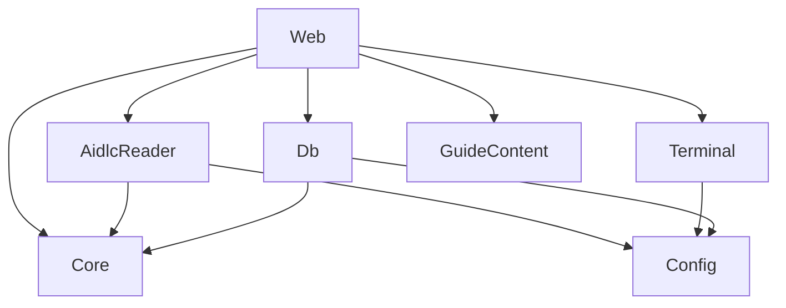

# Componentes lógicos: u1-walking-skeleton

Base: `inception/domain-design/components.md` e `TDD.md`. Esta Unidade não cria componentes novos, além do `logger`, que é um utilitário sem regra de negócio.

Em texto: `Web` recebe as requisições e chama os demais. `Core` não depende de nada. `AidlcReader` e `Db` usam o modelo do `Core` e a `Config`, e `Terminal` usa só a `Config`. O `logger` não aparece no grafo porque todos o usam e ele não depende de nenhum componente.

| Componente | Peças de U1 | Domínio de falha |
|---|---|---|
| `Core` | `decideMoment`, com o cálculo de `commandSent` | Função pura, sem falha de entrada ou saída |
| `AidlcReader` | Leitura de cursores, `aidlc-state.md` e grafo, e observador | Só afeta a etapa mostrada |
| `Terminal` | `TerminalManager` em `globalThis`, janela de blocos e ouvintes | Só afeta o terminal |
| `Db` | Migrações, `guide_progress` e `sent_command` | Fatal no início, e por requisição depois |
| `Config` | Variáveis, versão do Node.js, raiz e busca do shell | Fatal no início, exceto a raiz e o shell |
| `GuideContent` | `StageContent` e os textos de cada momento | Dado estático |
| `Web` | Páginas, rotas, `isRequestAllowed` e esquemas Zod | Por requisição |

## Limites conferidos na revisão do diff

- `Core` não conhece Next.js, SQLite nem o terminal.
- Só `Db` toca o banco, e `AidlcReader` não escreve em arquivos.
- Nenhum componente lê a janela de saída do `Terminal` para decidir o momento.
- `AidlcReader` não recebe referência ao `Terminal`, para que isso fique impossível de fazer por engano.
