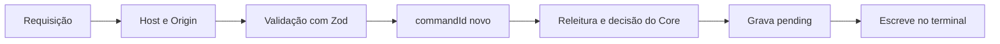

# Design de segurança: u1-walking-skeleton

Base: `nfr-requirements/security-requirements.md`, `functional-design/rules.md` e `inception/contract-design/contract-summary.md`.

## Camadas

Toda requisição que toca o terminal passa por estas camadas, nesta ordem:

Em texto: a origem é conferida primeiro, depois o formato, o `commandId` e a decisão. O texto só é gravado e escrito depois de tudo isso. As camadas de `commandId` e decisão valem para `/api/commands`. A rota `input` para na validação, porque é a digitação da própria pessoa.

## Escuta (NFR3.1, NFR3.2)

A `Config` entrega o endereço ao comando que inicia o Next, com `127.0.0.1` como padrão. O valor de `exposed` chega à interface pelo layout, que mostra o alerta em todas as telas, sem botão de fechar.

## Checagem de origem (NFR4.1, NFR4.2, NFR4.6)

Uma única função, `isRequestAllowed`, é chamada no início de todas as rotas de U1, inclusive as de leitura da decisão e da demanda, que também não devem ser lidas por outra página. Um teste percorre a lista de rotas e falha se alguma não passar por ela.

Com `VIBES_HOST` em `0.0.0.0`, não existe um nome único para comparar. Nesse caso, o `Host` aceito é o informado em `VIBES_PUBLIC_HOST`. Sem essa variável, o início avisa, e só `127.0.0.1` e `localhost` são aceitos.

| Situação | Resultado |
|---|---|
| `Host` em `127.0.0.1` ou `localhost`, na porta configurada | Aceito |
| `Host` igual a `VIBES_HOST`, na porta configurada, quando essa variável está definida | Aceito |
| `Host` ausente ou diferente | 403 `origin_rejected` |
| `POST` com `Origin` igual aos mesmos valores | Aceito |
| `POST` sem `Origin` ou com outro valor | 403 `origin_rejected` |
| `GET` do stream sem `Origin` | Aceito, porque o `EventSource` da mesma origem pode não enviá-lo |
| `GET` do stream com outro `Origin` | 403 `origin_rejected` |

A resposta nunca libera CORS. Isso cobre o ataque de uma página aberta no navegador e de DNS rebinding, que chega com um `Host` diferente.

## Entrada (NFR4.5, NFR4.7)

Os esquemas Zod ficam com o contrato de cada rota. Com entrada inválida, a resposta é 422, sem efeito.

| Rota | Limites |
|---|---|
| `/api/commands` | `commandId` uuid, texto de 1 a 8000 caracteres, sem quebra de linha, e `mode` em `execute` ou `paste` |
| `/api/terminal/input` | Até 64 KB |
| `/api/terminal/resize` | De 1 a 500 colunas e de 1 a 200 linhas |

## Envio (NFR4.3, NFR4.4)

O `commandId` é gerado só no clique de confirmação. Nenhuma outra parte da interface chama `/api/commands`, o que a revisão do diff confere. A rota compara a demanda e a etapa com a releitura e grava os valores da releitura (BR5.7).

## Conteúdo (NFR5.1)

A interface usa o `@xterm/xterm` para a saída e texto comum para os textos lidos dos arquivos, sem inserir HTML. A saída do terminal nunca é analisada.

## Dados e rede (NFR6.1, NFR7.1, NFR13.1, NFR13.2)

- Só o módulo `db` grava, e o caminho vem da configuração, dentro de `.vibes/`.
- O banco não tem coluna para saída do terminal. Só `sent_command` guarda o texto que a pessoa confirmou.
- As fontes vêm dos pacotes `@fontsource`. O `next.config` não aponta para recursos externos.
- O ambiente do shell herda o da pessoa. O produto não lê nem guarda variáveis dele além das que usa para o próprio início.

## Riscos aceitos

Os riscos de `nfr-requirements/security-requirements.md` continuam: sem login, um programa local pode chamar as rotas forjando os cabeçalhos, e com `VIBES_HOST` em outro endereço a proteção depende da rede da pessoa.
