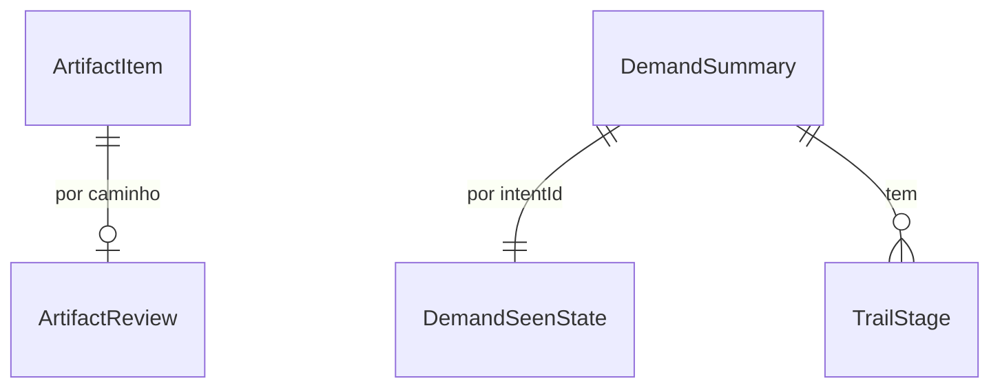

# Especificação funcional: u2-guide-flow

**Histórias (`inception/user-stories/stories.md`):** US3.5, US3.6, US4.1, US4.2, US4.3, US5.1 e US5.2.

Base: `inception/units-generation/unit-of-work.md`, `inception/refined-mockups/interaction-spec.md`, `inception/contract-design/contract-summary.md`, `entities.md` e `rules.md`. A aparência segue `design/prototipo/Main.dc.html`.

## Fluxos

### W1. Acompanhar e pergunta

1. A cada aviso `changed`, a interface pede a decisão de novo.
2. O `AidlcReader` lê o estado, os eventos do `audit/` e a posição do trabalho (BR1.2).
3. Com a demanda ativa, ele roda `aidlc engine log answers --stage <etapa>` e conta `open` (BR2.3).
4. Com algo em `open`, o momento é `question`, e a tela pede a resposta no terminal (BR2.1).
5. Sem isso, Acompanhar mantém a instrução genérica (BR2.2). Os artefatos novos aparecem na lista (BR1.1).

### W2. IA parada

1. A interface pede a decisão a cada 30 segundos enquanto está em Acompanhar.
2. Com `[-]` e 10 minutos sem mudança, a faixa aparece, com o texto de que a IA pode ter parado (BR3.1, BR3.2).
3. Retomar mostra o cartão com `/aidlc`, e nada vai ao terminal sem confirmação (BR3.3). Com outra CLI, fica só a orientação.
4. Quando um arquivo muda, a faixa some.

### W3. Revisar

1. Com `[?]`, a interface lista os artefatos da etapa, a partir do grafo de etapas e dos arquivos do registro.
2. O guia mostra um artefato por vez, como texto, com o caminho, a lista do que conferir e a contagem (BR4.1, BR4.2).
3. Marcar como revisado envia o caminho e o hash mostrado. A rota confere o hash atual e grava a revisão (BR4.4). Se o conteúdo mudou nesse meio-tempo, responde 409 `artifact_changed`, e a tela mostra o novo conteúdo.
4. Um artefato revisado cujo conteúdo muda volta a pedir revisão, com um aviso.

### W4. Aprovar e pedir alterações

1. Com tudo revisado, ou sem artefatos, o momento é `approve` (BR4.1).
2. A tela pede a resposta no terminal, com as opções como aparecem, e diz quantos artefatos faltam, sem impedir (BR5.1, BR2.4).
3. Com `[R]` ou `GATE_REJECTED`, o momento é `revising`, com a vez da IA (BR5.3).
4. Com `[?]` de novo, a aprovação é pedida de novo.

### W5. Conclusão

A aprovação do AI-DLC marca `[x]` na etapa, `[-]` na seguinte e atualiza `**Current Stage**` no mesmo ato. Por isso a conclusão é sempre da etapa anterior à atual, na ordem do plano.

1. Com a etapa anterior em `[x]` e `GATE_APPROVED` na tentativa dela, a posição vinda de `state` e a etapa atual ainda sem comando `written`, sem Entendi, sem artefatos e sem pergunta aberta, o momento é `conclusion` (BR5.2). Se a pessoa já foi em frente pelo terminal, o guia não volta a mostrar a conclusão.
2. A tela mostra o progresso da demanda, os artefatos revisados da etapa anterior e, se faltou algum, um aviso (BR6.1).
3. Ir para a próxima etapa grava o reconhecimento em `.vibes/`, em `guide_progress.conclusion_seen_at` da etapa anterior, e passa ao passo Entender da etapa atual, a que o AI-DLC já abriu (BR6.2). Nada é escrito em `aidlc/`.
4. Na última etapa, com `[x]` e `GATE_APPROVED`, o momento é `trail_done`, com a trilha concluída e o acesso ao histórico (BR6.3). A aba Histórico vem em U3, então U2 leva à lista de comandos enviados.

### W6. Reabrir o painel

1. Ao abrir, a interface compara o estado atual com `demand_seen_state` (BR7.1).
2. Se mudou, mostra o aviso do que mudou, com Entendi, e o momento atual. Entendi grava o estado atual.

### W7. Trilha

1. A trilha mostra as fases e as etapas, com o status em texto ou ícone (BR8.1). Na Construção, a etapa atual mostra também a Unidade.
2. Com a posição vinda do `audit/`, as etapas antes da atual sem `[x]` no `aidlc-state.md` aparecem como `previous`, com o texto "anterior", sem cadeado e sem afirmar que foram concluídas.
3. Selecionar uma etapa concluída mostra os artefatos dela. Uma bloqueada ou anterior não abre e não oferece comando (BR8.2).

## Momentos

A primeira condição verdadeira vale. As linhas de U3 ficam reservadas, sem efeito aqui.

| Ordem | Condição | Momento | Vez de | Ação |
|---|---|---|---|---|
| 1 | `repo.health` diferente de `ok` | `failure` | Pessoa | `retry` |
| 2 | `demand.isActive` falso | `not_active` | Pessoa | `activate` (U3) |
| 3 | `session.status` igual a `dead` | `session_dead` | Pessoa | `new_session` |
| 4 | `previous.gateApproved`, sem `previous.conclusionSeen`, `position.source` igual a `state`, `mark` em `pending` ou `in_progress`, sem `gateRejected`, sem `understood`, `commandSent` igual a `none`, `artifactsTotal` igual a zero e sem pergunta aberta | `conclusion` | Guia | `next_stage` |
| 5 | `mark` em `approved`, `gateApproved`, sem próxima | `trail_done` | Guia | `none` |
| 6 | `mark` em `approved` nos demais casos, `skipped` ou `unknown` | `following` | Pessoa | `none` |
| 7 | `mark` em `awaiting_approval`, com artefato não revisado | `review` | Pessoa | `mark_reviewed` |
| 8 | `mark` em `awaiting_approval` | `approve` | Pessoa | `none` |
| 9 | `openQuestions` maior que zero | `question` | Pessoa | `none` |
| 10 | `mark` em `revising`, ou `gateRejected` | `revising` | IA | `none` |
| 11 | `position.source` igual a `audit` | `following` | IA | `none` |
| 12 | `commandSent` igual a `executed` | `following` | IA | `none` |
| 13 | `commandSent` igual a `pasted` | `pasted` | Pessoa | `none` |
| 14 | `understood` verdadeiro | `send` | Pessoa | `send` |
| 15 | Demais casos | `understand` | Pessoa | `understood` |

A linha 8 cobre o gate mesmo sem comando enviado pelo guia, porque a pessoa pode ter usado o terminal. A pergunta do próprio gate não conta na linha 9, porque as linhas 7 e 8 vêm antes dela. A faixa de IA parada é um aviso adicional em `following` e em `revising`, com `showIdleNotice`.

`canSend` é verdadeiro no momento `send`, ou em `following` e `revising` com `showIdleNotice`, com `repo.health` igual a `ok`, a demanda ativa, a sessão `alive` e `cliKind` igual a `claude_code`. Em `conclusion` e `trail_done`, é sempre falso.

`previous` é a etapa anterior à atual, na ordem do plano, sem as puladas. `previous.gateApproved` exige `[x]` no `aidlc-state.md` e `GATE_APPROVED` na tentativa dela, sem `Unit`.

### Na Construção

Enquanto a etapa atual do `aidlc-state.md` está em `[-]` e o `audit/` tem um evento de Unidade da execução atual, `position.source` é `audit`. Nesse caso:

- a tela mostra "Unidade · etapa", a partir do último `UNIT_STARTED`, e a marca da etapa mostrada não vem do `aidlc-state.md`;
- `mark` é lida como `in_progress`, `gateApproved` e `gateRejected` são falsos, e não há lista de artefatos, então as linhas 4 a 8 não valem;
- só restam `question` e `following`. Um evento de Unidade já indica que a IA está trabalhando, então Entender e Enviar não aparecem;
- os checkpoints de Unidade chegam como perguntas registradas, e o guia não afirma que uma Unidade foi aprovada;
- Retomar, na faixa de IA parada, é a única forma de enviar um comando.

Como Entender e Enviar não aparecem dentro de uma Unidade, `guide_progress` e `sent_command` continuam com a chave de U1, sem colisão entre Unidades. Quando a etapa atual do `aidlc-state.md` sair de `[-]`, como nos gates finais da Construção, a fonte volta a ser `state`, e valem `mark`, `hasNextStage` e as demais linhas.

### Tentativa atual e artefatos

- **Tentativa atual:** os eventos depois do último `STAGE_STARTED` da etapa. `gateApproved` e `gateRejected` olham o último evento de gate dessa tentativa, e um novo `STAGE_STARTED` zera os dois.
- **Artefatos de uma etapa:** os arquivos da pasta `<fase>/<etapa>/` do registro, sem `memory.md`, `*-questions.md`, `traceability.json`, `reviews/` e arquivos começando com `.aidlc`. Sem nenhum arquivo, `artifactsTotal` é zero, e o momento é `approve`.

## Máquina de estados do artefato

| Estado | Evento | Próximo |
|---|---|---|
| `pending` | Marcar como revisado | `reviewed` |
| `reviewed` | O conteúdo mudou | `changed` |
| `changed` | Marcar como revisado | `reviewed` |

## Casos de borda

| Caso | Comportamento |
|---|---|
| `audit/` com várias cópias locais (um arquivo por clone) | Lê todas e ordena pela data |
| Entrada incompleta no fim do arquivo | É ignorada e lida de novo na próxima mudança (BR1.3) |
| `log answers` demora mais de 1,5 segundo | Conta como `unavailable` nessa leitura |
| Texto da pergunta com instruções | Não é mostrado nem interpretado. O guia usa só a contagem |
| Artefato binário ou muito grande | Mostra o caminho e o motivo (BR4.3) |
| Terminal abaixo de 1180 pixels | Fica embaixo do guia, com altura própria, e é recolhível |

## Prova desta Unidade

O script no navegador usa uma cópia de teste de um registro real, em uma pasta temporária, escrita pelo próprio script, sem créditos de IA. Ele percorre `[-]`, pergunta aberta, `[?]`, revisão com hash, conteúdo alterado, `[R]`, a aprovação como o AI-DLC a grava (etapa anterior em `[x]` com `GATE_APPROVED`, atual em `[-]` e `**Current Stage**` atualizado), a última etapa em `[x]`, aviso aos 10 minutos com data de arquivo antiga e reabertura com mudança. Ele confere o `git status` da cópia antes e depois de tudo: além do que o script escreveu, nada muda, nem em `aidlc/`.

A conferência de ponta a ponta com uma etapa real deste intent, conduzida pelo guia, é feita por quem desenvolve e prepara o teste com uma pessoa nova.

## Diagrama de entidades

Em texto: cada artefato pode ter uma revisão, cada demanda tem um último estado visto e várias etapas na trilha.

## Resumo das regras

Derivado de `rules.md`: leitura e posição (BR1), perguntas (BR2), IA parada (BR3), Revisar (BR4), Aprovar e alterações (BR5), conclusão (BR6), reabrir o painel (BR7), trilha (BR8) e segurança (BR9).

## Acréscimos aos contratos

- C1: `stage.unit`, `stage.gateApproved`, `stage.gateRejected`, `previous` e o valor `guide` em `turn`, já previsto.
- C2: `listArtifacts(intentId, stageSlug)` e `readWorkPosition(intentId)`.
- C3: a migração `0002_u2.sql` cria `artifact_review` e `demand_seen_state`, esta com a coluna `unit`, porque o aviso de reabertura precisa distinguir Unidades, e acrescenta `guide_progress.conclusion_seen_at`. A cópia prévia do banco de U1 vale para ela.
- C4: `/api/demands/{intentId}/artifacts`, `/api/demands/{intentId}/artifacts/review`, `/api/demands/{intentId}/seen`, `/api/demands/{intentId}/trail` e `/api/demands/{intentId}/conclusion`.

## Pontos resolvidos nesta Unidade

| Origem | Decisão |
|---|---|
| Pedido de alterações e tabela de momentos | Linha 10 e BR5.3 |
| Último estado visto | `demand_seen_state` (BR7.1) |
| Rotas de `understood`, `mark_reviewed` e `next_stage` | `understood` veio de U1. `mark_reviewed` é a rota de revisão. `next_stage` é a rota `conclusion`, que grava só o reconhecimento em `.vibes/`, porque a etapa seguinte vem dos arquivos |
| Conclusão no fluxo real, decisão de quem desenvolve depois da revisão de código | Vale pela etapa anterior (BR5.2 e BR6.2), porque a etapa atual nunca fica em `[x]` depois de aprovada |
| Trilha na Construção, decisão de quem desenvolve depois da revisão de código | Estado `previous`, com o texto "anterior" (BR8.1) |
| Contrato de `GuideContent` | `StageContent`, `MomentContent` e `ReviewChecklist` |
| Terminal empilhado | Abaixo de 1180 pixels, com altura própria e recolhível |
| Leitura de perguntas só da demanda ativa | BR2.3 |

## Assumptions & Open Questions

- [assumption] O texto das opções do gate vem dos protocolos do AI-DLC e pode mudar. O guia cita só `Approve` e `Request Changes`.
- [assumption] O evento `GATE_REJECTED` e a marca `[R]` ainda não apareceram em uma execução real. A prova usa a forma documentada, e a confirmação entra em `FEEDBACK-AIDLC.md`.
- [assumption] O AI-DLC emite `STAGE_STARTED` ao refazer uma etapa depois de um pedido de alterações. Se não emitir, o guia fica em `revising` até o gate seguinte, sem afirmar nada falso. A confirmação entra em `FEEDBACK-AIDLC.md`.
- [open] O teste com uma pessoa nova acontece logo depois deste Bolt, e a pessoa ainda precisa ser definida.
