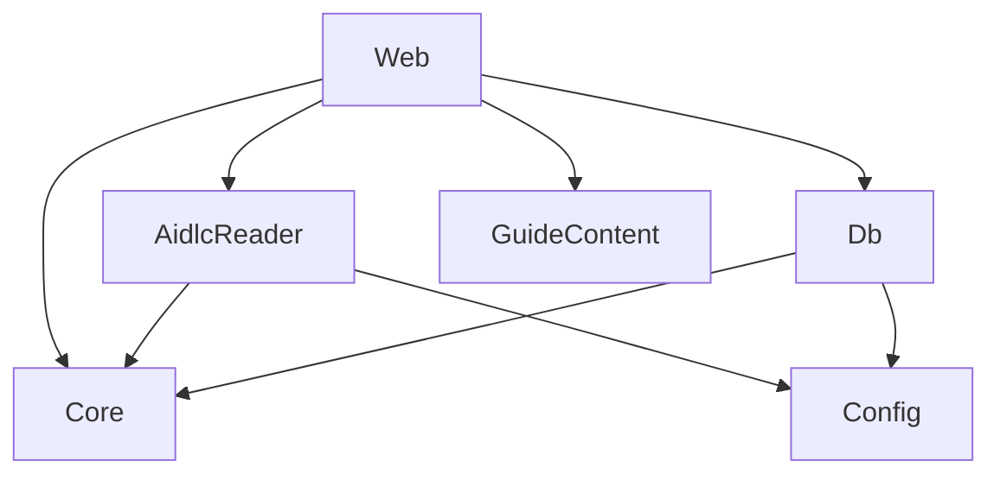

# Componentes lógicos: u2-guide-flow

Base: `inception/domain-design/components.md`. Sem componentes novos e sem mudar o sentido das dependências.

Em texto: `Web` recebe as requisições e chama os demais. `Core` não depende de nada. `AidlcReader` e `Db` usam o modelo do `Core` e a `Config`.

| Componente | Peças de U2 | Domínio de falha |
|---|---|---|
| `Core` | Tabela de 15 linhas, `showIdleNotice` e cálculo da trilha | Função pura |
| `AidlcReader` | Eventos do `audit/`, posição do trabalho, `readOpenQuestionCount`, `listArtifacts` e `resolveArtifactPath` | Só afeta o que é lido, com recuo à instrução genérica |
| `Db` | `0002_u2.sql`, `artifactReviewRepo` e `demandSeenRepo` | Por requisição |
| `GuideContent` | `ReviewChecklist` e os textos dos momentos novos | Dado estático |
| `Web` | Rotas novas e telas de Revisar, Aprovar, conclusão, trilha e faixas | Por requisição |

## Divergência registrada

`team.md` diz que "o `aidlc` só lê arquivos", e o ADR-002 de `inception/domain-design/decisions.md` já permite executar comandos de leitura. Este design usa a forma do ADR-002.
