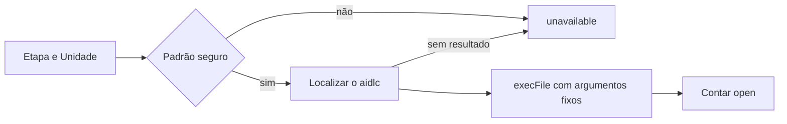

# Design de segurança: u2-guide-flow

Base: `nfr-requirements/security-requirements.md` e `nfr-requirements/tech-stack-decisions.md` de U2, `functional-design/functional-spec.md` e `inception/contract-design/contract-summary.md`.

## Comando de perguntas (NFR5.2)

Em texto: etapa e Unidade passam pelo padrão seguro, depois o `aidlc` é localizado e, só então, o comando roda.

- Uma única função, `readOpenQuestionCount`, monta o comando. Ela recebe só `stage` e `unit`, e os dois precisam seguir `^[a-z0-9][a-z0-9-]*$`.
- O padrão não aceita espaços nem os caracteres especiais do `cmd.exe`, como `&`, `|`, `^`, `%`, `<`, `>` e `"`, nem valores começando com `-`, então nenhum valor do `audit/` consegue virar outro comando ou outra opção. Por isso a passagem pelo `cmd.exe` é segura aqui.
- A chamada é `execFile('cmd.exe', ['/d /s /c ""' + aidlcPath + '" engine log answers --stage ' + stage + ' --unit ' + unit + '"'], { windowsVerbatimArguments: true })`. As aspas externas são as que o `/s` retira, e as internas mantêm o caminho inteiro, com espaços e acentos. `--unit` entra só na Construção.
- `aidlcPath` vem de `VIBES_AIDLC` ou de uma busca nas pastas do `PATH` feita pelo próprio Node.js, sem `where`. A busca só aceita pastas com caminho absoluto, porque uma entrada como `.` apontaria para o repositório, onde um commit de outra pessoa poderia colocar um `aidlc.cmd`. Em cada pasta, procura só `aidlc.cmd`.
- O caminho é recusado, com a contagem em `unavailable`, se tiver `"`, `%`, `!`, `&`, `|`, `<`, `>` ou `^`. Espaços, acentos e parênteses, como em `Program Files (x86)`, são aceitos dentro das aspas.
- Um teste real no Windows roda o comando a partir de uma cópia do `aidlc.cmd` em uma pasta com espaço e acento.
- Ao esgotar o limite, a árvore de processos é encerrada com `killProcessTree`, de U1, porque o `timeout` do `execFile` encerraria só o `cmd.exe`.
- A saída é tratada como dado não confiável: o leitor interpreta o JSON e usa só o tamanho de `open`.

## Artefatos (NFR5.1, NFR5.4)

Uma função, `resolveArtifactPath`, junta o caminho ao registro do intent, resolve `..` e links com `realpath` e recusa o que sair do registro. A rota responde 404 nesse caso. Acima de 2 MB, responde com o caminho e o motivo, sem o conteúdo. A interface mostra o conteúdo em um `pre`, como texto, sem inserir HTML.

## Rotas (NFR4.1)

As rotas novas chamam `isRequestAllowed` e validam a entrada com Zod. O teste de U1 que percorre todos os `route.ts` passa a cobri-las sem alteração.

## Pergunta e escrita (NFR5.3, NFR6.1, NFR7.1)

O texto das perguntas não sai do `AidlcReader`, porque a função devolve só um número. O produto continua escrevendo só pelo `Db`, em `.vibes/`. A prova confere o `git status` e as datas de `aidlc/` antes e depois do comando, e o comando continua como risco aceito quanto à rede.
