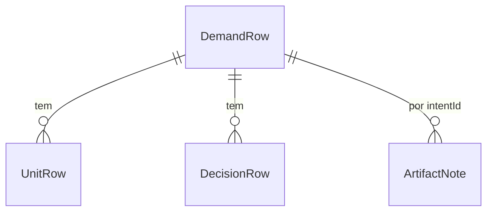

# Especificação funcional: u3-demands

**Histórias (`inception/user-stories/stories.md`):** US2.1, US2.2, US2.3, US6.1, US6.2 e US6.3.

Base: `inception/units-generation/unit-of-work.md`, `inception/refined-mockups/mockups.md`, `inception/contract-design/contract-summary.md`, `entities.md` e `rules.md`. A aparência segue `design/prototipo/Main.dc.html`.

## Fluxos

### W1. Início

1. O painel abre no Início, que lista as demandas do espaço ativo (BR4.1).
2. A demanda ativa vem primeiro e abre o guia. As demais abrem em modo de consulta (BR5.1).
3. Sem demandas, mostra a instrução e Nova demanda (BR4.2). Um registro ilegível mostra o aviso na própria linha (BR4.3).

Quem já tem uma demanda ativa e abre o painel continua vendo o guia dela, como em U1 e U2. O Início fica a um clique, pela marca no topo.

### W2. Nova demanda

1. **Descrever:** a pessoa escreve o que quer fazer. Continuar fica desativado até haver texto (BR1.1).
2. **Escolher o nível:** o guia sugere um nível, com o motivo (BR1.2), e a pessoa pode trocar (BR1.3). Pedir análise mostra o comando para confirmar (BR2.1), e a tela continua no passo.
3. **Confirmar:** o guia mostra o comando (BR1.5), o lembrete de que a IA precisa estar aberta e os botões de envio. Com Outra CLI, é só uma referência.
4. Depois de confirmar, a tela diz que está esperando a IA criar a demanda e que ela pode perguntar algo no terminal (BR3.1, BR3.2). Quando o registro aparece, a demanda surge no Início (BR3.3).

Cancelar volta ao Início em qualquer passo (BR1.4).

### W3. Demanda não ativa

1. A faixa de consulta aparece no topo, com o motivo e Tornar esta demanda ativa (BR5.2).
2. Tornar ativa mostra `/aidlc intent switch <nome>` para confirmar (BR5.3).
3. Quando o cursor muda, o guia relê, e a demanda passa a ser conduzida normalmente (BR5.4).

### W4. Ativa mudou com o painel aberto

1. O observador percebe a mudança no cursor, e a interface pede a decisão de novo.
2. A demanda aberta passa a `not_active`, com a faixa (BR5.4).
3. Um envio com a tela antiga recebe 409 `stale_screen` ou `not_active`, e nada é escrito.

### W5. Abas

- **Artefatos:** lista os artefatos por etapa, com a leitura de U2, mostrados como texto. A pessoa escreve notas (BR6.2).
- **Unidades e ciclos:** lista as Unidades e o estado delas (BR6.3).
- **Decisões:** lista tipo, etapa, data e texto (BR6.4).
- **Histórico:** lista os comandos enviados pelo painel (BR6.5).

Aba vazia ou arquivo ilegível seguem BR6.6. Trocar de aba não muda o momento (BR6.1).

## Máquina da nova demanda

| Passo | Evento | Próximo |
|---|---|---|
| `describe` | Continuar, com texto | `level` |
| `level` | Continuar | `confirm` |
| `confirm` | Voltar | `level` |
| `level` | Voltar | `describe` |
| Qualquer | Cancelar | Início |
| `confirm` | Comando `written`, em execução ou colado | `waiting` |
| `waiting` | Registro novo apareceu | Início, com a demanda em destaque |

Recarregar a página descarta o rascunho, por ser estado da tela, como no protótipo.

## Tabela de sugestão

Teste de aceitação de BR1.2:

| Descrição | Nível |
|---|---|
| corrigir erro no login | `bugfix` |
| corrigir a vulnerabilidade CVE-2026-1234 | `security-patch` |
| refatorar o módulo de pagamentos | `refactor` |
| configurar terraform para a fila | `infra` |
| prova de conceito de busca | `poc` |
| criar o MVP do catálogo | `mvp` |
| oficina de treinamento da equipe | `workshop` |
| fluxo com auditoria e LGPD | `enterprise` |
| ajuste pequeno no rodapé | `express` |
| adicionar filtro por data na lista | `feature` |

A primeira regra que combina vale. Assim, "corrigir a vulnerabilidade" dá `security-patch`, porque essa regra vem antes de `bugfix`.

## Comandos

| Situação | Comando |
|---|---|
| Nova demanda, com outra em andamento | `/aidlc --new-intent --scope <nível> "<descrição>"` |
| Nova demanda, sem nenhuma em andamento | `/aidlc --scope <nível> "<descrição>"` |
| Análise do nível | `/aidlc compose "<descrição>"` |
| Tornar ativa | `/aidlc intent switch <nome>` |

Fontes: `aidlc engine orchestrate help` (`intent switch`, `compose`) e `.claude/skills/aidlc-bugfix/SKILL.md` (`--new-intent`). Demanda em andamento é a ativa com o registro legível e com alguma etapa que não esteja em `[x]` ou pulada.

## Casos de borda

| Caso | Comportamento |
|---|---|
| Descrição com aspas duplas ou quebras de linha | Aspas viram simples, e quebras viram espaço, antes de montar o comando (BR1.5) |
| Comando editado pela pessoa no cartão | Vale o texto editado, sem conferir a forma, como em U1 |
| Nome de pasta inseguro em `intents/` | É ignorado na lista |
| IA não aberta no terminal | A espera continua, com a instrução de conferir o terminal depois de 10 minutos |
| Intent arquivado | Fica de fora da lista, conforme `intents.json`. Se o arquivo faltar, vale a lista de pastas |
| Texto de `audit/` com HTML ou instruções | Mostrado como texto, sem efeito |

## Prova desta Unidade

O script no navegador usa uma cópia de teste, sem créditos de IA. Ele cobre: Início com várias demandas e uma ilegível; a tabela de sugestão; nova demanda até o comando chegar ao Git Bash, com o guia esperando e a demanda surgindo quando o script grava o registro; consulta de uma não ativa sem mudar o cursor; envio recusado; tornar ativa com confirmação; troca do cursor com o painel aberto; nota sem mudar o artefato; e as quatro abas, inclusive vazias.

A conferência de ponta a ponta com uma demanda real, levada até o código gerado, é feita por quem desenvolve.

## Diagrama de entidades

Em texto: cada demanda, lida dos arquivos, tem Unidades e decisões, e as notas ficam no banco, apontando para ela.

## Resumo das regras

Derivado de `rules.md`: nova demanda (BR1), análise pela IA (BR2), depois de confirmar (BR3), Início (BR4), demanda não ativa (BR5), abas (BR6) e segurança (BR7).

## Acréscimos aos contratos

- C2: `listDemands` ganha os campos de `DemandRow`, além de `readUnits(intentId)` e `readDecisions(intentId)`.
- C3: a migração `0003_u3.sql` cria `artifact_note` e acrescenta `kind` a `sent_command`, com o padrão `stage`. As colunas `intent_id` e `stage_slug` continuam como estão e guardam texto vazio quando não se aplicam.
- C4: `/api/demands/new/command`, `/api/demands/{intentId}/activate`, `/api/demands/{intentId}/notes`, `/api/demands/{intentId}/units`, `/api/demands/{intentId}/decisions` e `/api/demands/{intentId}/commands`.
- Contrato de `Triage`: `suggestLevel(description) -> LevelSuggestion`.

## Pontos resolvidos nesta Unidade

| Origem | Decisão |
|---|---|
| Regras e tabela de sugestão de nível | Tabela acima, testável, vinda do protótipo |
| Demanda ativa com o painel aberto | W4 e BR5.4 |
| Comando de ativação | `/aidlc intent switch <nome>`, confirmado no framework instalado |
| Rotas de artefato, notas e nova demanda | Acréscimos a C4 |
| Contrato de `Triage` | `suggestLevel` |
| Leitura de perguntas só da demanda ativa | BR5.2 |
| Aprovação de Unidade | O `audit/` traz o sinal em `GATE_APPROVED` com `Gate Scope` igual a `unit-end`. A aba Unidades e ciclos o mostra (BR6.3), e o momento do guia continua sem afirmar aprovação de Unidade |

## Assumptions & Open Questions

- [assumption] `/aidlc --scope <nível> "<descrição>"` cria a demanda quando nenhuma está em andamento. Isso vem do `PRD.md` e da documentação do framework, e a conferência real depende da IA aberta, então fica com quem desenvolve.
- [assumption] A noção de demanda em andamento do guia olha só a ativa, e o AI-DLC olha todas as do espaço. Se divergirem, o AI-DLC pode perguntar no terminal, o que a tela de espera avisa. `--new-intent` não aparece na lista do `help`, só no código e em `aidlc-bugfix/SKILL.md`. A conferência fica com quem desenvolve e entra em `FEEDBACK-AIDLC.md`.
- [assumption] `/aidlc compose "<descrição>"` responde com um plano, sem criar a demanda, conforme o `help`.
- [open] O formato de `unit-of-work.md` é o desta execução, com a tabela no início. Se outro registro vier diferente, a aba mostra o arquivo como ilegível.
