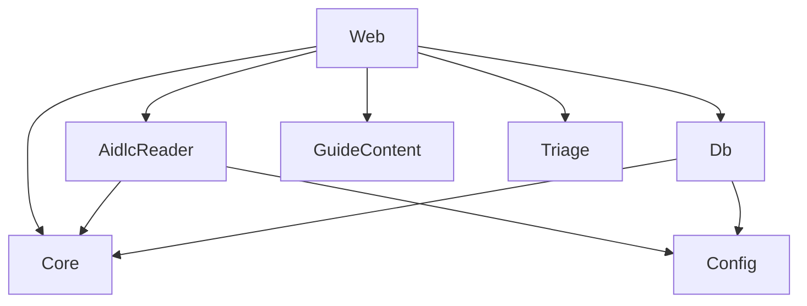

# Componentes lógicos: u3-demands

Base: `inception/domain-design/components.md`. `Triage` já estava previsto no catálogo, e U3 o constrói. As dependências não mudam de sentido.

Em texto: `Web` chama os demais. `Triage`, `Core` e `GuideContent` não dependem de nada. `AidlcReader` e `Db` usam o modelo do `Core` e a `Config`.

| Componente | Peças de U3 | Domínio de falha |
|---|---|---|
| `Triage` | `suggestLevel` e `buildNewDemandCommand` | Função pura |
| `AidlcReader` | `listDemands`, `readUnits` e `readDecisions` | Por registro ou por aba |
| `Db` | `0003_u3.sql`, `artifactNoteRepo` e filtro por `kind` | Por requisição |
| `GuideContent` | Textos de nova demanda, de abas vazias e da faixa | Dado estático |
| `Web` | Início, três passos, abas, faixa e rotas novas | Por requisição |
