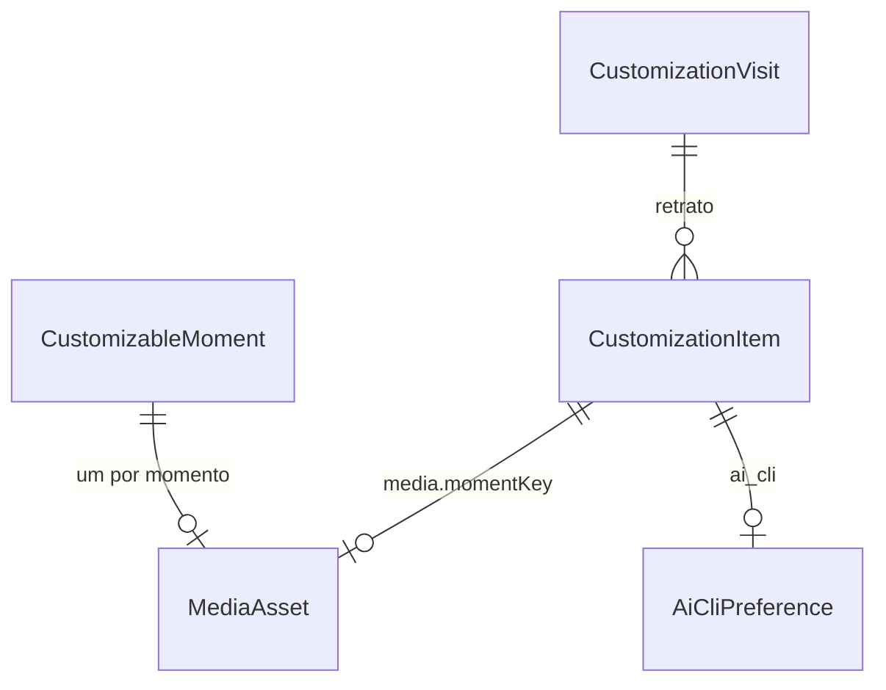

# Especificação funcional: u4-customization

**Histórias (`inception/user-stories/stories.md`):** US3.7, US7.1 e US7.2.

Base: `inception/units-generation/unit-of-work.md`, `inception/refined-mockups/mockups.md`, `inception/contract-design/contract-summary.md`, `entities.md` e `rules.md`. A aparência segue `design/prototipo/Main.dc.html`.

## Fluxos

### W1. Abrir Personalizar

1. A pessoa abre Personalizar pelo topo. O guia pede uma visita nova, e o servidor guarda o retrato das linhas de `customization_item` (BR4.3).
2. A tela mostra, de cima para baixo: Imagens e vídeos, com a lista de momentos e a prévia; Frases; Cores; Sua IA; e a lista do que fica fixo (BR2.2).
3. Os valores originais aparecem quando não há linha. Enquanto a leitura não chega, a prévia é um esqueleto.

Abrir em outra aba começa uma visita nova (BR4.4).

### W2. Trocar imagem ou vídeo

1. A pessoa escolhe o momento e o arquivo. O guia envia o arquivo com `momentKey` e `visitId` (BR7.4).
2. O servidor confere tamanho e conteúdo (BR1.1, BR1.2). Se o arquivo vale, grava um arquivo novo e troca a referência do momento (BR1.3, BR5.1).
3. A prévia mostra a nova mídia no momento. Um arquivo recusado mostra o motivo, e a anterior continua.
4. Voltar ao original é um `PUT` com `media.<momento>: null`, que apaga a referência do momento (BR4.1).

### W3. Trocar frases

1. A pessoa escolhe o momento e edita o título e o texto. Os campos mostram as marcações aceitas (BR2.1).
2. Cada campo salva ao sair dele. Campo vazio volta ao original. A prévia troca as marcações por valores de exemplo.
3. O guia mostra a frase como texto (BR2.3).

### W4. Trocar cores

1. Cada uma das oito cores tem um seletor e um campo #rrggbb (BR3.1). Escolher salva e aplica na hora (BR3.2).
2. Se o contraste ficar abaixo do mínimo, a tela mostra o aviso e mantém a cor (BR3.3).
3. Voltar ao original apaga a cor. O logo muda de cor com `brand`, mas o desenho dele e o favicon não mudam (BR3.4).

### W5. Sua IA

1. A seção mostra "Qual CLI você usa no terminal?", com Claude Code selecionado na primeira vez e a opção Outra CLI (BR6.1).
2. Escolher salva. No passo Enviar, com Outra CLI, o guia mostra o comando para o Claude Code como referência, sem botão de envio (BR6.2), e acompanha como sempre (BR6.3).
3. Não há botão para abrir a IA nem detecção da CLI (BR6.4).

### W6. Concluir, Cancelar e Restaurar tudo

- **Concluir** mantém tudo, apaga os arquivos que ficaram sem uso e volta à tela anterior (BR4.3).
- **Cancelar** desfaz tudo o que mudou na visita, inclusive Sua IA, e volta à tela anterior (BR4.3).
- **Restaurar tudo** pede uma confirmação na própria tela e volta imagens, frases e cores ao original (BR4.2).

## Máquina da visita

| Estado | Evento | Próximo |
|---|---|---|
| Sem visita | Abrir Personalizar | `aberta`, com retrato |
| `aberta` | Alterar, enviar mídia (com `visitId`), voltar ao original | `aberta` |
| Sem visita | Enviar mídia | 409 `stale_visit`, nada gravado |
| `aberta` | Concluir | Sem visita, arquivos sem uso apagados |
| `aberta` | Cancelar | Sem visita, linhas do retrato regravadas e arquivos novos apagados |
| `aberta` | Abrir Personalizar em outra aba | `aberta` (nova), com a anterior sem desfazer |
| `aberta` | Servidor reinicia | Sem visita, o salvo permanece (BR4.5) |
| Sem visita | Ação com visitId antigo | 409 `stale_visit` (BR4.4) |

## Momentos personalizáveis

Lista fixa em `GuideContent` (`CUSTOMIZABLE_MOMENTS`). Cada momento troca a arte (imagem ou vídeo), o título e o texto. O texto de apoio, os rótulos de botão e as ações ficam fixos (BR2.2).

| `momentKey` | Onde aparece | Marcações |
|---|---|---|
| `home` | Início | |
| `new_describe` | Nova demanda, passo 1 | |
| `new_level` | Nova demanda, passo 2 | `{nivel}`, `{motivo}` |
| `new_confirm` | Nova demanda, passo 3 | |
| `understand` | Entender a etapa | `{etapa}`, `{descricao}` |
| `send` | Confirmar o comando | |
| `pasted` | Comando colado | |
| `following` | IA trabalhando (só a vez da IA) | `{etapa}` |
| `question` | Pergunta da IA | |
| `review` | Revisar os artefatos | |
| `approve` | Aprovar | |
| `revising` | Pedir alterações | |
| `conclusion` | Etapa concluída | |
| `trail_done` | Trilha concluída | |
| `session_dead` | Sessão encerrada (só a arte) | |
| `not_active` | Demanda não ativa (só a arte) | |

**Só a arte:** `session_dead` e `not_active` têm `textEditable` falso, porque o título deles é a instrução do que fazer para destravar o guia (BR2.2).

**Quem compõe:** o `Web` monta o `MomentContent` com o texto padrão de `GuideContent`, troca `title` e `text` pelas frases de `customization` quando há, substitui as marcações com o contexto que só ele tem (etapa, descrição, nível, motivo) e troca `art` pela URL da mídia. `GuideContent` continua estático e não importa `db` nem `customization`. A lista `CUSTOMIZABLE_MOMENTS`, com `momentKey`, `tokens` e `textEditable`, vive em `GuideContent`.

**Fora da lista:** `failure`, porque a instrução de falha diz o que fazer quando o guia não funciona. A tela Personalizar e a vez da pessoa em `following` também ficam fora. Os momentos do protótipo `syncing`, `nocli` e `done` não existem no `Core` e não entram.

## Cores

| Chave | Rótulo | Original | Efeito |
|---|---|---|---|
| `brand` | Logo e título | `#ff385c` | Fundo do logo e título do Vibes DLC |
| `accent` | Destaque | `#ff385c` | Botão principal e destaques, com hover, preenchimento e cor sobre o destaque derivados |
| `text` | Texto | `#222222` | Títulos e texto |
| `muted` | Texto de apoio | `#6a6a6a` | Rótulos e descrições |
| `bg` | Fundo | `#ffffff` | Página e cartões |
| `soft` | Preenchimentos | `#f7f7f7` | Áreas leves e fase atual |
| `line` | Bordas | `#dddddd` | Linhas e divisórias |
| `ok` | Sucesso | `#04694a` | Etapas concluídas, com o fundo derivado |

Os avisos de contraste olham `brand`, `text` e `muted` contra `bg` (BR3.3).

**Variáveis CSS (`src/app/globals.css`):** cada chave e cada cor derivada aplica o valor às variáveis que já existem, como no protótipo.

| Origem | Variáveis |
|---|---|
| `brand` | `--brand` |
| `accent` | `--green`, `--furDark` |
| derivada hover | `--green2`, `--greenText` |
| derivada preenchimento | `--leaf` |
| derivada cor sobre o destaque | `--onAccent` (nova variável, usada no texto do botão principal) |
| `text` | `--ink`, `--night`, `--blue`, `--blueText` |
| `muted` | `--gray` |
| `bg` | `--paper` |
| `soft` | `--wash`, `--mint`, `--furLight` |
| `line` | `--line`, `--faded` |
| `ok` | `--ok` |
| derivada fundo do sucesso | `--okSoft` |

Voltar ao original remove a propriedade do elemento raiz, e o `globals.css` volta a valer.

## Contratos

| Contrato | Acréscimo |
|---|---|
| C3 | Migração `0004_u4.sql` cria `customization_item` (`item_key` único, `kind` com `color`, `say`, `media` ou `cli`, `value`, `updated_at`). O `db` expõe um repositório de texto puro (BR7.3) |
| C4 | `GET /api/customization`; `PUT /api/customization` com `visitId`, `colors`, `says`, `media` (só `null`) e `cliKind` (`null` volta ao original), e a resposta traz a personalização atual com os avisos de contraste; `POST /api/customization/visit`; `POST /api/customization/visit/done`; `POST /api/customization/visit/cancel`; `POST /api/customization/media`; `GET /api/customization/media/{mediaId}`. Restaurar tudo é um `PUT` com `resetAll: true`, sem outras chaves |
| C7 | `readCliKind() -> claude_code \| other`, com `claude_code` como padrão. `Web` o coloca no retrato |
| Erros | `{ code, message }` com `invalid_value` (422), `unsupported_type` (415), `too_large` (413), `stale_visit` (409), `save_failed` (500) e `origin_rejected` (403) |

A leitura devolve: cores originais mais as personalizadas, as derivadas, os avisos de contraste, as frases por momento, a URL da mídia por momento, `cliKind` e o `visitId` aberto. O envio de mídia é `multipart/form-data` com `file`, `momentKey` e `visitId` (BR7.4). Estes acréscimos a C4 (rotas novas e os erros `stale_visit`, `save_failed` e `origin_rejected`) são incorporados a `contract-summary.md` na geração de código desta Unidade, e até lá este arquivo é a fonte.

## Casos de borda

| Caso | Comportamento |
|---|---|
| PNG renomeado para `.svg`, ou SVG renomeado para `.png` | Vale o conteúdo: o primeiro é aceito como PNG, o segundo é recusado (BR1.1, BR1.2) |
| Arquivo de 0 byte ou de 25 MB mais 1 byte | Recusado, com o motivo (BR1.1) |
| Vídeo em momento sem espaço para vídeo | Tocado sem som, em repetição, no lugar da arte, com respeito à redução de movimento |
| Frase só com espaços | Volta ao original (BR2.1) |
| Frase com `<script>` ou HTML | Mostrada como texto (BR2.3) |
| Marcação desconhecida, como `{x}` | Fica como foi escrita (BR2.1) |
| Cor `#fff`, `red` ou `#12345g` | 422 `invalid_value` (BR3.1) |
| Cor com contraste baixo | Salva, com aviso (BR3.3) |
| Disco cheio ao gravar mídia | Aviso, arquivo parcial apagado, anterior mantido (BR5.1) |
| `.vibes/media/` apagada à mão | O momento mostra a arte original, e a leitura ignora a referência quebrada sem erro e sem gravar no banco (BR4.5) |
| Duas abas em Personalizar | A mais antiga recebe `stale_visit` e relê (BR4.4) |
| Servidor reiniciado com visita aberta | Permanece o que foi salvo, sem desfazer (BR4.5) |
| Sua IA trocada com um comando já colado | O momento passa a seguir `cliKind`. O que já foi colado no terminal não é desfeito |
| Banco novo, sem `customization_item` | A migração cria a tabela, e tudo mostra os valores originais |

## Prova desta Unidade

O script no navegador usa uma cópia de teste e cobre: trocar a arte de um momento por um PNG válido e vê-la aparecer; recusar SVG, um arquivo disfarçado e um arquivo acima de 25 MB, mantendo a anterior; voltar ao original; Cancelar desfazendo uma visita com mídia, frase, cor e Sua IA; aviso de contraste sem bloqueio; o logo com nova cor e o favicon igual; Outra CLI deixando Enviar sem botão; e `git status` limpo fora de `.vibes/`.

Os testes de unidade cobrem a detecção de tipo por conteúdo, o cálculo das cores e dos contrastes, as marcações, a visita e a falha de gravação. A conferência visual da tela fica com quem desenvolve.

## Diagrama de entidades

Em texto: toda personalização é uma linha de `customization_item`. A mídia e a escolha de Sua IA são linhas especiais, e a visita guarda uma cópia das linhas para Cancelar.

## Resumo das regras

Derivado de `rules.md`: imagens e vídeos (BR1), frases (BR2), cores (BR3), restaurar, visita e Cancelar (BR4), falha ao gravar (BR5), Sua IA (BR6) e escrita, rotas, ciclo de tipos e envio (BR7).

## Pontos resolvidos nesta Unidade

| Origem | Decisão |
|---|---|
| Ciclo de tipos entre `Db` e `Customization` (revisão do design de domínio) | O repositório em `db` usa texto puro e não importa de `customization` (BR7.3), com um teste de arquitetura |
| Limite de corpo e formato de envio da mídia (C4) | `multipart/form-data`, com recusa antecipada pelo `Content-Length` (BR7.4). O comportamento do Next.js diante do limite é conferido na geração |
| `VIBES_CLI_KIND`, criada em U3 como atalho | Substituída pela escolha salva em Sua IA e removida (BR6.4) |
| Onde mora a escolha de Sua IA | Item `ai_cli` da mesma tabela, sem tabela nova (BR6.1) |
| Cancelar e Sua IA | Cancelar também desfaz a escolha de Sua IA da visita (BR4.3) |

## Assumptions & Open Questions

- [assumption] Cada mudança é gravada na hora, e Cancelar a desfaz pelo retrato da visita. Foi escolhido por seguir o protótipo, que aplica as mudanças na prévia e restaura no Cancelar. A alternativa seria guardar um rascunho e gravar só em Concluir.
- [assumption] Restaurar tudo não muda Sua IA, por ser uma preferência de trabalho e não de aparência.
- [assumption] Nenhum critério de `stories.md` cobre as frases (FR10.1). As regras BR2 vêm direto dos requisitos e entram em `traceability.json` como regras sem critério.
- [assumption] A lista de 16 momentos personalizáveis corresponde aos momentos do `Core` mais as telas de Início e Nova demanda. O protótipo lista 18 entradas com nomes diferentes.
- [open] Se o Next.js impõe um limite de corpo às rotas de uma aplicação sem `proxy`, e qual. Confere-se na geração de código e, se houver limite abaixo de 25 MB, a rota lê o corpo em partes.
- [open] A forma de detectar assinatura de MP4 e WebM sem biblioteca externa. O NFR Requirements de U4 decide se vale uma dependência pequena ou uma checagem própria dos bytes iniciais.
