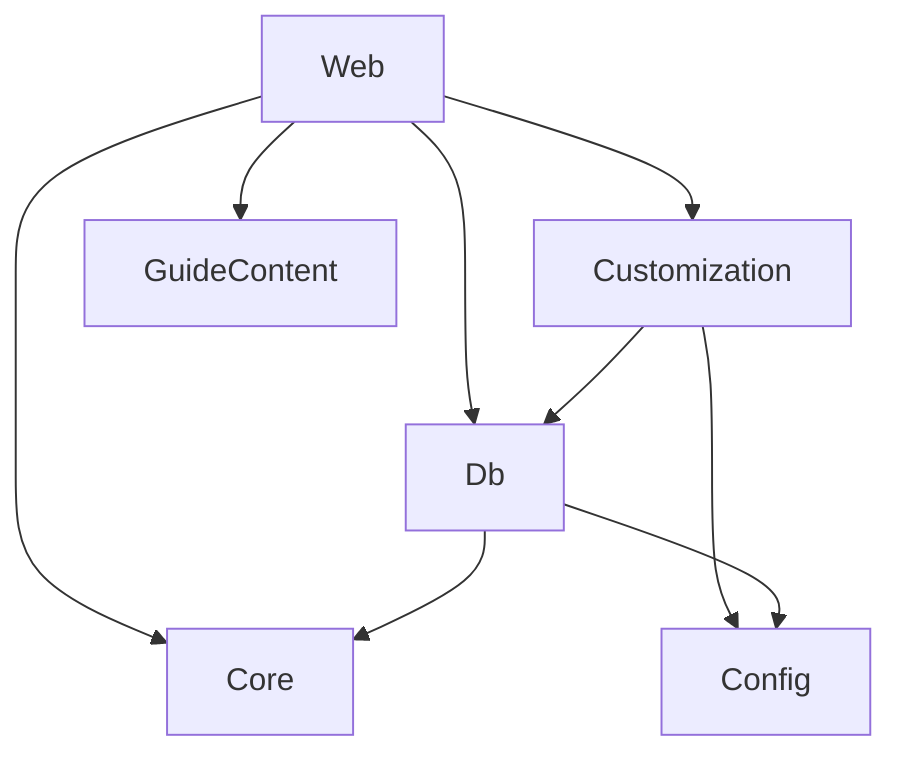

# Componentes lógicos: u4-customization

Base: `inception/domain-design/components.md`. `Customization` já estava no catálogo, e U4 o constrói. As dependências não mudam de sentido, e o repositório de `customization_item` no `Db` não importa tipos de `Customization` (BR7.3).

Em texto: `Web` chama `Customization`, `GuideContent`, `Core` e `Db`. `Customization` usa `Db` e `Config`. `Db` não conhece `Customization`.

| Componente | Peças de U4 | Domínio de falha |
|---|---|---|
| `Customization` | `detectMediaType`, `validateColor`, `deriveColors`, `contrastWarnings`, `applyTokens`, a visita, a fila de gravação, a varredura de mídia e `readCliKind` | Por requisição; a visita e a fila vivem no processo |
| `Db` | `0004_u4.sql` e o repositório de texto puro de `customization_item`, com `all()`, `upsert(row)`, `remove(itemKey)` e `replaceAll(rows)`, esta última em uma transação | Por requisição |
| `GuideContent` | `CUSTOMIZABLE_MOMENTS`, com `tokens` e `textEditable` | Dado estático |
| `Config` | `vibesDir` e `mediaDir`, que U4 acrescenta ao `AppConfig` como `vibesDir/media` | Início |
| `Web` | Tela Personalizar, rotas `/api/customization/*` (que validam `momentKey` e `textEditable` contra `CUSTOMIZABLE_MOMENTS`), semáforo de upload, composição de `MomentContent` e aplicação das cores | Por requisição |

## Onde cada padrão de NFR vive

| Padrão | Componente |
|---|---|
| Leitura em partes com contagem e interpretação do multipart | `Web` (rota de mídia) |
| Detecção por assinatura | `Customization` |
| Fila única, atomicidade e Cancelar em transação | `Customization`, com a transação em `Db` |
| Cabeçalhos da mídia | `Web` (rota de servir) |
| Varredura de arquivos sem uso | `Customization`, chamada pelo ponto de montagem do runtime |
