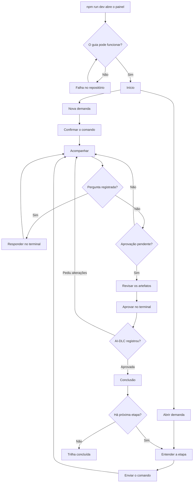

# Fluxo do usuário: MVP do Vibes DLC

Base: `ideation/intent-capture/intent-statement.md`, `ideation/scope-definition/scope-document.md`, `ideation/scope-definition/intent-backlog.md` e as telas de `wireframes.md`.

## Fluxo principal

Quem usa: pessoas de engenharia, Tech Leads, Arquitetos e Product Owners que já usam IA por linha de comando.

<!-- Text fallback: o painel confere se o guia pode funcionar; se não puder, mostra a falha e tenta de novo. Do Início, a pessoa cria ou abre uma demanda. Em cada etapa, ela entende, envia o comando e acompanha. Perguntas registradas são respondidas no terminal. Com a aprovação pendente, ela revisa e aprova no terminal. Se pedir alterações, volta a acompanhar; se aprovar, vê a conclusão e segue até a trilha terminar. -->

Em texto: o painel confere se pode funcionar. Do Início, a pessoa cria ou abre uma demanda. Em cada etapa, ela entende, envia o comando e acompanha a IA. Quando há pergunta, responde no terminal. Com a aprovação pendente, revisa os artefatos e aprova no terminal. Depois vê a conclusão e segue para a próxima etapa, até a trilha terminar.

## Fluxos detalhados

### F1. Registrar uma demanda

- **Gatilho:** Nova demanda, no Início.
- **Passos:**
  1. Descrever -> escrever uma ou duas frases -> o guia sugere o nível e mostra o motivo.
  2. Escolher o nível -> confirmar, trocar ou pedir análise à IA -> o guia monta o comando.
  3. Confirmar o comando -> editar, se quiser, e enviar ou colar -> o comando vai ao terminal.
- **Resultado:** a demanda aparece no Início, lida dos arquivos do AI-DLC.
- **Caminhos de erro:**
  - descrição vazia -> Continuar fica desativado, com o motivo;
  - Cancelar -> volta ao Início, sem enviar nada.

### F2. Conduzir uma etapa

- **Gatilho:** abrir a etapa atual na trilha.
- **Passos:**
  1. Entender -> ler o que a etapa faz -> Entendi, continuar.
  2. Enviar -> conferir o comando, ver o lembrete sobre a IA aberta -> Enviar agora ou Colar sem executar.
  3. Acompanhar -> ver os artefatos surgirem e responder no terminal quando houver pergunta.
  4. Revisar -> ler um artefato por vez -> Marcar como revisado.
  5. Aprovar -> responder no terminal -> o guia lê a aprovação no registro.
- **Resultado:** a conclusão mostra o progresso e quantos artefatos foram revisados.
- **Caminhos de erro:**
  - comando enviado com a IA fechada -> o Git Bash recebe o comando, e o lembrete orienta a abrir a IA e enviar de novo;
  - sessão encerrada -> o envio fica desativado até abrir uma nova sessão;
  - comando colado -> o guia pede para pressionar Enter e só percebe a execução pelos arquivos;
  - IA pergunta sem registrar -> a instrução genérica fica sempre visível;
  - pedido de alterações -> volta a Acompanhar, e a aprovação é pedida de novo;
  - aprovação sem revisar tudo -> a conclusão avisa, sem bloquear.

### F3. Usar outra CLI

- **Gatilho:** escolher Outra CLI na seção "Sua IA" da personalização.
- **Passos:**
  1. Personalizar -> escolher Outra CLI -> Salvar.
  2. Enviar -> ver o comando de referência e a orientação -> digitar o comando no terminal.
  3. Acompanhar -> o guia segue pelos arquivos, como no fluxo principal.
- **Resultado:** a pessoa conduz a etapa sem o envio automático.
- **Caminho de erro:** a CLI não entende o comando -> a pessoa o ajusta no terminal, e o guia continua esperando os arquivos.

### F4. Reabrir o painel

- **Gatilho:** abrir o painel depois de trabalhar no terminal sem ele.
- **Passos:** o guia lê os arquivos -> compara com o que sabia -> avisa o que mudou -> mostra o momento atual.
- **Resultado:** a pessoa continua de onde a etapa está.
- **Caminho de erro:** registro que não pode ser lido -> tela de falha no repositório (E6 em `wireframes.md`).

### F5. Personalizar

- **Gatilho:** Personalizar, no topo.
- **Passos:** escolher o momento -> trocar imagem, vídeo ou frase -> trocar as cores -> escolher a CLI -> Salvar.
- **Resultado:** o guia usa as escolhas, e cada item pode voltar ao original.
- **Caminhos de erro:**
  - arquivo inválido -> mostra o motivo e mantém o anterior;
  - contraste baixo -> mostra o aviso, sem bloquear;
  - Cancelar -> desfaz o que mudou naquela visita.

## De onde vem cada momento

| Momento | De quem é a vez | Sinal lido dos arquivos do AI-DLC | Situação |
|---|---|---|---|
| Etapa em andamento | IA | Marca `[-]` e `STAGE_STARTED` | Confirmado |
| Pergunta registrada | Pessoa | Lista `open` de `aidlc engine log answers` | Confirmado |
| Resumo aguardando confirmação | Pessoa | `[Answer]:` em branco em `## Consolidated Summary Confirmation` | Hipótese |
| Aprovação pendente | Pessoa | Marca `[?]` e `STAGE_AWAITING_APPROVAL` | Confirmado |
| Aprovada | Guia | Marca `[x]` e `GATE_APPROVED` | Confirmado |
| Pedido de alterações | IA | Marca `[R]` | Hipótese |
| Comando colado e executado | Pessoa | Sem sinal direto; só pelos arquivos depois | Hipótese |

## Assumptions & Open Questions

- [assumption] Os sinais marcados como hipótese ainda precisam de execução real, conforme `FEEDBACK-AIDLC.md`.
- [assumption] A pessoa com outra CLI sabe qual é o comando equivalente; o guia só dá a referência do Claude Code.
- [open] Como a pessoa percebe, de forma simples, que enviou o comando com a IA fechada? O lembrete reduz o risco, mas o guia não detecta esse caso.
