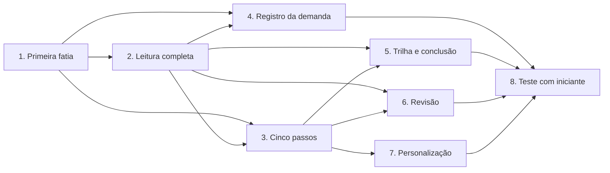
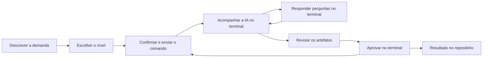

# Backlog da intenção: MVP do Vibes DLC

Referências: `scope-document.md`, `ideation/intent-capture/intent-statement.md`, `ideation/feasibility/feasibility-assessment.md`, `ideation/feasibility/constraint-register.md` e `ideation/feasibility/raid-log.md`.

## Método

Usamos MoSCoW. Como todos os itens são obrigatórios (respostas Q1 e Q2), a classificação não define a ordem. A ordem vem da resposta Q6: risco primeiro. Risco e dependências são estimativas qualitativas.

Estes itens são candidatos a Unidades. A divisão final acontece em Geração de Unidades.

## Itens em ordem de construção

| Ordem | Item | Requisitos do PRD | MoSCoW | Risco que reduz | Depende de |
|---|---|---|---|---|---|
| 1 | Primeira fatia: painel, terminal real, etapa lida dos arquivos e comando com confirmação | 2, 3, 4 (parte), 9 | Must | R1, R2, R3 (alto) | Nenhum |
| 2 | Leitura completa do AI-DLC: estado, artefatos, decisões, histórico e reconciliação ao reabrir | 4, 6, 8, 10 | Must | R2, R3 (alto) | 1 |
| 3 | Condução em cinco passos, com envio e histórico de comandos | 3, 7, 11 | Must | R5 (médio) | 1, 2 |
| 4 | Registro da demanda, com nível sugerido por regras locais | 1, 5, 8 | Must | Baixo | 1, 2 |
| 5 | Trilha das etapas e tela de conclusão | 12, 14 | Must | Baixo | 2, 3 |
| 6 | Revisão de um artefato por vez | 4, 13 | Must | R5 (médio) | 2, 3 |
| 7 | Personalização de imagens, vídeos, frases e cores | 15 | Must | Baixo | 3 |
| 8 | Teste com uma pessoa que nunca usou o AI-DLC | Meta de sucesso | Must | A2, A3, D4 | 1 a 7 |

Os requisitos 16 (textos genéricos) e 17 (português) valem para todos os itens com interface.

## Dependências

Em texto: a primeira fatia vem antes de tudo. A leitura completa vem em seguida. Os cinco passos e o registro da demanda dependem das duas. Trilha, revisão e personalização vêm depois dos cinco passos. O teste com iniciante fecha o MVP.

## Mapa do fluxo de valor

O mapa mostra o caminho de uma demanda com o guia pronto. Não há medições de tempo: ainda não existe produto para medir.

Em texto: a pessoa descreve a demanda, escolhe o nível e confirma o comando. A IA trabalha no terminal e faz perguntas. Depois a pessoa revisa os artefatos e aprova no terminal. O ciclo se repete a cada etapa, até o resultado no repositório.

| Passo | De quem é a vez | Onde a pessoa pode travar | Item que trata |
|---|---|---|---|
| Descrever a demanda e escolher o nível | Pessoa | Não saber qual nível escolher | 4 |
| Confirmar e enviar o comando | Pessoa | Não saber qual comando usar | 1, 3 |
| Acompanhar a IA | IA | Não saber se ainda é a vez da IA | 1, 2, 3 |
| Responder perguntas | Pessoa | Não perceber uma pergunta; a IA pode perguntar sem registrar (R3) | 2, 3 |
| Revisar os artefatos | Pessoa | Aprovar sem revisar (R5) | 6 |
| Aprovar no terminal | Pessoa | Não perceber que a aprovação está pendente | 2, 3 |
| Ver o resultado | Pessoa | Não saber o que falta | 5 |

## Assumptions & Open Questions

- [assumption] A divisão em oito itens é uma proposta inicial. Ela pode mudar em Geração de Unidades.
- [assumption] Os riscos R2 e R3 continuam abertos depois do item 1, por isso reaparecem no item 2. A Construção ainda não foi observada.
