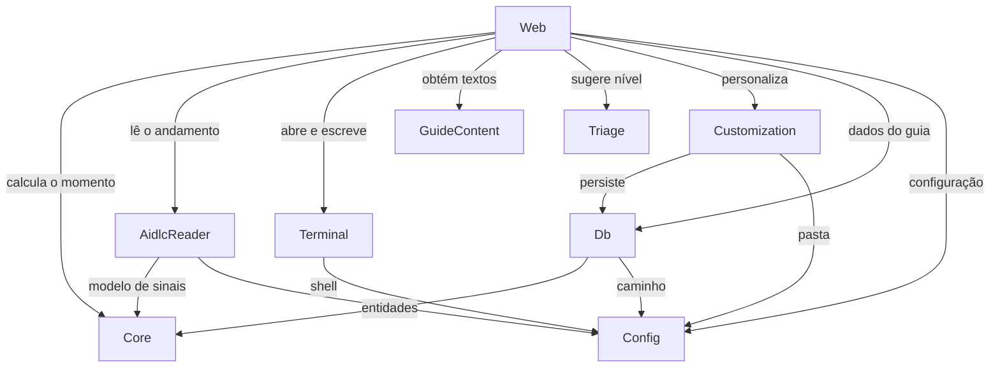

# Componentes: MVP do Vibes DLC

Base: `inception/requirements-analysis/requirements.md`, `inception/user-stories/stories.md`, `inception/practices-discovery/team-practices.md`, `inception/refined-mockups/interaction-spec.md` e `TDD.md`. As decisões estão em `decisions.md`.

Os componentes são os módulos do `TDD.md`, confirmados em `team-practices.md`. Esta etapa não define a topologia de implantação.

```yaml
components:
  - name: Core
    summary: Regras do guia, sem depender de framework, banco, terminal ou arquivos.
    behaviour: >
      Calcula o momento do guia a partir de um retrato dos sinais, seguindo a ordem de prioridade
      de interaction-spec.md. Libera o comando da etapa seguinte só com a etapa atual aprovada.
      Permite envio só para a demanda ativa, com sessão viva e CLI Claude Code. Avalia o aviso de IA
      parada com 10 minutos sem mudança e etapa em andamento. Marca um artefato para revisar de novo
      quando o hash muda. Nunca faz entrada ou saída.
    responsibilities:
      - Máquina de estados dos momentos e passos do guia
      - Regras de liberação de etapa e de permissão de envio
      - Regra do aviso de IA parada
      - Regra de revisão por hash de artefato
    depends_on: []
    dependents:
      - component: AidlcReader
        interaction: Traduz os arquivos do AI-DLC para o modelo de sinais do Core
      - component: Db
        interaction: Persiste as entidades do Core
      - component: Web
        interaction: Pede o momento atual e valida as ações da pessoa
    entities:
      - name: GuideProgress
        identifier: intentId + stageSlug
        attributes: [intentId, stageSlug, currentStep, understoodAt]
        references:
          - entity: Demand
            owned_by: AidlcReader
            relationship: cada progresso pertence a uma demanda, pelo identificador do intent
      - name: ArtifactReview
        identifier: intentId + artifactPath
        attributes: [intentId, artifactPath, contentHash, reviewedAt]
        references:
          - entity: Demand
            owned_by: AidlcReader
            relationship: cada revisão pertence a uma demanda
      - name: ArtifactNote
        identifier: noteId
        attributes: [noteId, intentId, artifactPath, text, createdAt]
        references:
          - entity: Demand
            owned_by: AidlcReader
            relationship: cada nota pertence a uma demanda
      - name: SentCommand
        identifier: commandId
        attributes: [commandId, intentId, stageSlug, text, mode, sentAt]
        references:
          - entity: Demand
            owned_by: AidlcReader
            relationship: cada comando enviado pertence a uma demanda

  - name: AidlcReader
    summary: Lê o estado do AI-DLC e traduz para o modelo do guia, sem escrever nada.
    behaviour: >
      Resolve o espaço e o intent ativos pelos cursores. Lê aidlc-state.md, audit/, os artefatos e
      stage-graph.json. Executa aidlc engine log answers com limite de tempo para obter perguntas
      abertas; se o comando faltar ou falhar, informa sinal indisponível, e o guia usa a instrução
      genérica. Ignora campos desconhecidos, pula entradas malformadas e mantém o último estado válido
      diante de um arquivo incompleto. Informa a data da última mudança no registro. Observa os arquivos
      e avisa quando mudam. Monta o comando de cada etapa. Trata o conteúdo lido como dado não confiável.
    responsibilities:
      - Leitura de cursores, estado, registro, artefatos e grafo de etapas
      - Consulta de perguntas abertas pelo comando de leitura
      - Observação dos arquivos do AI-DLC
      - Montagem dos comandos do AI-DLC
    depends_on:
      - component: Core
        interaction: Usa o modelo de sinais do Core
        style: sync
      - component: Config
        interaction: Obtém a raiz do repositório
        style: sync
    dependents:
      - component: Web
        interaction: Lê demandas, etapas, artefatos e mudanças
    external_dependencies:
      - name: Arquivos do AI-DLC em aidlc/ e .claude/tools/data/
        kind: other
        purpose: Fonte da verdade do andamento
      - name: Comando aidlc engine log answers
        kind: other
        purpose: Lista de perguntas abertas
    entities:
      - name: Demand
        identifier: intentId
        attributes: [intentId, title, scope, currentStage, isActive, readable, lastChangedAt]
      - name: StageState
        identifier: intentId + stageSlug
        attributes: [intentId, stageSlug, phase, mark, artifacts]
        references: []
      - name: RecordedDecision
        identifier: intentId + timestamp + kind
        attributes: [intentId, stageSlug, kind, text, timestamp]

  - name: Terminal
    summary: Mantém as sessões do pseudo-terminal vivas no servidor.
    behaviour: >
      Abre o shell na ordem VIBES_SHELL e bash.exe da instalação do Git, sem cair para PowerShell ou cmd.
      Mantém a sessão ao recarregar a página, guarda as últimas linhas para reconexão e distribui a saída
      a todas as abas. Não interpreta a saída. Rejeita um segundo envio com o mesmo identificador.
    responsibilities:
      - Ciclo de vida da sessão
      - Entrada, saída, redimensionamento e encerramento
      - Buffer para reconexão
    depends_on:
      - component: Config
        interaction: Obtém o shell e a raiz do repositório
        style: sync
    dependents:
      - component: Web
        interaction: Abre, escreve e transmite a sessão
    external_dependencies:
      - name: node-pty
        kind: other
        purpose: Pseudo-terminal real
      - name: Git Bash
        kind: other
        purpose: Shell da sessão no Windows
    entities:
      - name: TerminalSession
        identifier: sessionId
        attributes: [sessionId, status, startedAt, buffer]

  - name: GuideContent
    summary: Conteúdo estático do guia em português.
    behaviour: >
      Fornece nomes, descrições, listas do que conferir e frases padrão de cada momento, sem acessar
      arquivos do AI-DLC. Etapa sem conteúdo próprio recebe um texto genérico.
    responsibilities:
      - Textos de fases, etapas, artefatos e momentos
      - Mapa de artes padrão por momento
    depends_on: []
    dependents:
      - component: Web
        interaction: Monta as telas com os textos
    entities:
      - name: MomentContent
        identifier: momentKey
        attributes: [momentKey, title, phrase, artKey]

  - name: Triage
    summary: Sugere o nível da demanda por regras locais.
    behaviour: >
      Aplica regras locais de palavras-chave sobre a descrição e devolve o nível e o motivo, com um nível
      padrão quando nenhuma regra casa. Gera o texto do pedido de análise à IA. Não chama modelo.
    responsibilities:
      - Regras de sugestão de nível
      - Texto do pedido de análise
    depends_on: []
    dependents:
      - component: Web
        interaction: Pede a sugestão na nova demanda
    entities:
      - name: LevelSuggestion
        identifier: descriptionHash
        attributes: [descriptionHash, scope, reason]

  - name: Customization
    summary: Valida, salva e restaura a personalização e a escolha da CLI.
    behaviour: >
      Valida mídia pelo conteúdo, recusa SVG e arquivos acima de 25 MB, mantendo o item anterior em
      caso de erro. Calcula cores derivadas e avisos de contraste, sem bloquear. Guarda a escolha Sua IA.
      Nunca altera estrutura, etapas, comandos, terminal ou desenho do logo.
    responsibilities:
      - Imagens, vídeos, frases e cores por momento
      - Preferência Sua IA
      - Restaurar e cancelar
    depends_on:
      - component: Db
        interaction: Persiste valores e referências às mídias
        style: sync
      - component: Config
        interaction: Obtém a pasta .vibes
        style: sync
    dependents:
      - component: Web
        interaction: Lê e altera a personalização
    external_dependencies:
      - name: Sistema de arquivos em .vibes/media/
        kind: object-store
        purpose: Guarda as mídias enviadas
    entities:
      - name: CustomizationItem
        identifier: itemKey
        attributes: [itemKey, kind, value, updatedAt]
      - name: MediaAsset
        identifier: mediaId
        attributes: [mediaId, momentKey, filePath, contentType, sizeBytes]
      - name: AiCliPreference
        identifier: preferenceKey
        attributes: [preferenceKey, cliKind]

  - name: Db
    summary: Esquema, migrações e acesso ao banco local.
    behaviour: >
      É o único componente que toca o banco. Aplica migrações numeradas que só avançam, copiando
      .vibes/vibes.db antes de migrar. Guarda só o que o AI-DLC não guarda. Não guarda cópia da demanda.
    responsibilities:
      - Migrações
      - Persistência das entidades de Core e Customization
    depends_on:
      - component: Core
        interaction: Usa os tipos das entidades do Core
        style: sync
      - component: Config
        interaction: Obtém o caminho do banco
        style: sync
    dependents:
      - component: Customization
        interaction: Persiste a personalização
      - component: Web
        interaction: Lê e grava progresso, revisões, notas e comandos
    external_dependencies:
      - name: SQLite em .vibes/vibes.db
        kind: database
        purpose: Dados locais do guia
    entities: []

  - name: Config
    summary: Lê e valida a configuração no início.
    behaviour: >
      Valida as variáveis opcionais, com padrões. Localiza a raiz do repositório AI-DLC a partir da
      subpasta. Confere a versão do Node.js. Sinaliza quando VIBES_HOST não é 127.0.0.1.
    responsibilities:
      - Variáveis de ambiente e padrões
      - Localização da raiz do repositório
      - Verificação de versão do Node.js
    depends_on: []
    dependents:
      - component: AidlcReader
        interaction: Fornece a raiz do repositório
      - component: Terminal
        interaction: Fornece o shell e a raiz
      - component: Customization
        interaction: Fornece a pasta .vibes
      - component: Db
        interaction: Fornece o caminho do banco
      - component: Web
        interaction: Fornece host, porta e o sinal de exposição
    entities:
      - name: AppConfig
        identifier: singleton
        attributes: [port, host, dbPath, shellPath, repoRoot, exposed]

  - name: Web
    summary: Telas e rotas, com entrada, saída e delegação.
    behaviour: >
      Compõe os demais componentes. Só escreve no terminal depois de uma ação explícita, com um
      identificador de envio. Rejeita Origin ou Host de fora nas rotas do terminal e de personalização.
      Exibe artefatos e frases como texto. Transmite atualizações por SSE. Mostra o alerta de exposição.
      Não contém regra de negócio.
    responsibilities:
      - Telas do guia, trilha, abas e personalização
      - Rotas internas e transmissão por SSE
      - Validação de origem
      - Composição dos componentes
    depends_on:
      - component: Core
        interaction: Calcula o momento e valida as ações
        style: sync
      - component: AidlcReader
        interaction: Obtém demandas, etapas, artefatos e mudanças
        style: event
      - component: Terminal
        interaction: Abre, escreve e transmite a sessão
        style: event
      - component: GuideContent
        interaction: Obtém os textos
        style: sync
      - component: Triage
        interaction: Obtém a sugestão de nível
        style: sync
      - component: Customization
        interaction: Lê e altera a personalização
        style: sync
      - component: Db
        interaction: Lê e grava os dados do guia
        style: sync
      - component: Config
        interaction: Obtém a configuração
        style: sync
    dependents: []
    external_dependencies:
      - name: Next.js
        kind: other
        purpose: Interface e rotas
      - name: xterm
        kind: other
        purpose: Terminal no navegador
    entities: []
```

## Component Diagram



Em texto: `Web` compõe todos os componentes. `Core`, `GuideContent`, `Triage` e `Config` não dependem de nenhum outro. `AidlcReader` e `Db` usam o modelo do `Core` e a `Config`. `Terminal` usa a `Config`. `Customization` usa `Db` e `Config`. O grafo não tem ciclos.

## Component Summary

| Component | Purpose | Depends On | Dependents | Entities Owned |
|---|---|---|---|---|
| Core | Regras do guia | | AidlcReader, Db, Web | GuideProgress, ArtifactReview, ArtifactNote, SentCommand |
| AidlcReader | Leitura do AI-DLC | Core, Config | Web | Demand, StageState, RecordedDecision |
| Terminal | Sessões do terminal | Config | Web | TerminalSession |
| GuideContent | Textos do guia | | Web | MomentContent |
| Triage | Sugestão de nível | | Web | LevelSuggestion |
| Customization | Personalização e Sua IA | Db, Config | Web | CustomizationItem, MediaAsset, AiCliPreference |
| Db | Banco local | Core, Config | Customization, Web | |
| Config | Configuração | | AidlcReader, Terminal, Customization, Db, Web | AppConfig |
| Web | Telas e rotas | Todos os demais | | |

## Entity Ownership

| Entity | Owning Component | Identifier | Attributes | References |
|---|---|---|---|---|
| GuideProgress | Core | intentId + stageSlug | currentStep, understoodAt | Demand |
| ArtifactReview | Core | intentId + artifactPath | contentHash, reviewedAt | Demand |
| ArtifactNote | Core | noteId | artifactPath, text, createdAt | Demand |
| SentCommand | Core | commandId | stageSlug, text, mode, sentAt | Demand |
| Demand | AidlcReader | intentId | title, scope, currentStage, isActive, readable, lastChangedAt | |
| StageState | AidlcReader | intentId + stageSlug | phase, mark, artifacts | |
| RecordedDecision | AidlcReader | intentId + timestamp + kind | stageSlug, kind, text | |
| TerminalSession | Terminal | sessionId | status, startedAt, buffer | |
| MomentContent | GuideContent | momentKey | title, phrase, artKey | |
| LevelSuggestion | Triage | descriptionHash | scope, reason | |
| CustomizationItem | Customization | itemKey | kind, value, updatedAt | |
| MediaAsset | Customization | mediaId | momentKey, filePath, contentType, sizeBytes | |
| AiCliPreference | Customization | preferenceKey | cliKind | |
| AppConfig | Config | singleton | port, host, dbPath, shellPath, repoRoot, exposed | |

`Db` não possui entidades: guarda as de `Core` e `Customization`, que continuam donos das regras.

## External Dependencies

| Component | Dependency | Kind | Purpose |
|---|---|---|---|
| AidlcReader | Arquivos do AI-DLC | other | Fonte da verdade do andamento |
| AidlcReader | `aidlc engine log answers` | other | Perguntas abertas |
| Terminal | `node-pty` | other | Pseudo-terminal real |
| Terminal | Git Bash | other | Shell da sessão |
| Customization | `.vibes/media/` | object-store | Mídias enviadas |
| Db | SQLite | database | Dados locais do guia |
| Web | Next.js | other | Interface e rotas |
| Web | xterm | other | Terminal no navegador |

## Rationale

| Component | Why separate |
|---|---|
| Core | Regras que mudam por decisão de produto e precisam de teste sem infraestrutura |
| AidlcReader | Muda quando o formato do AI-DLC muda, que é o maior risco externo |
| Terminal | Ciclo de vida próprio no servidor, com módulo nativo e risco de plataforma |
| GuideContent | Muda por revisão de texto, sem lógica |
| Triage | Regras próprias, testáveis por tabela de exemplos |
| Customization | Dados e validações próprios, além do risco de segurança com mídia |
| Db | Concentra migrações e o acesso ao banco, conforme `team-practices.md` |
| Config | Validação no início, usada por quase todos |
| Web | Entrada e saída, separadas das regras |

**Decomposição:** uma única decomposição é viável aqui, porque os módulos já foram definidos no `TDD.md` e confirmados em `team-practices.md`. As alternativas de fronteira estão em `decisions.md`.

## Assumptions & Open Questions

- [assumption] `Web` trata o estilo `event` como a transmissão por SSE de mudanças nos arquivos e da saída do terminal.
- [open] A forma de observar arquivos no Windows será validada na primeira fatia, contra o limite de 3 segundos.
- [open] O comando de ativação da demanda, `/aidlc intent <nome>`, será confirmado na primeira fatia.
