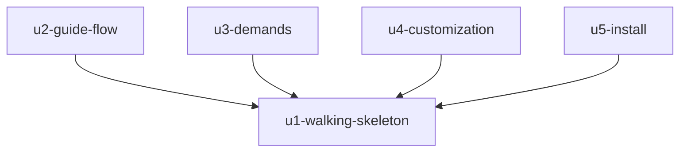

# Dependências entre Unidades: MVP do Vibes DLC

Base: `unit-of-work.md`, `inception/domain-design/components.md` e `inception/domain-design/decisions.md`. Este documento descreve só a topologia. A ordem de construção é decidida no planejamento de entrega.

```yaml
units:
  - name: u1-walking-skeleton
    kind: service
    depends_on: []
  - name: u2-guide-flow
    kind: service
    depends_on: [u1-walking-skeleton]
  - name: u3-demands
    kind: service
    depends_on: [u1-walking-skeleton]
  - name: u4-customization
    kind: service
    depends_on: [u1-walking-skeleton]
  - name: u5-install
    kind: packaging
    depends_on: [u1-walking-skeleton]
```

## Grafo



Em texto: U2, U3, U4 e U5 dependem de U1, e não há outras dependências. Uma seta indica "depende de". O grafo não tem ciclos.

## Fatia de ponta a ponta

`u1-walking-skeleton` é a primeira Unidade do grafo, porque não depende de nenhuma outra. Ela roda sozinha neste repositório: `npm run dev` abre o painel, o terminal real abre no Git Bash, o guia lê a etapa do intent ativo e envia o comando com confirmação.

## Pontos de integração

Todas as Unidades ficam no mesmo processo, então a integração é por chamadas de módulo, sem rede entre elas.

| De | Para | Ponto | Dados |
|---|---|---|---|
| U2, U3, U4 | U1 | `Core` | Retrato de sinais, momento e ações permitidas |
| U2, U3 | U1 | `AidlcReader` | Demandas, etapas, artefatos e aviso de mudança |
| U2, U3, U4 | U1 | `Db` | Migrações próprias de cada Unidade |
| U2, U3, U4 | U1 | Estrutura de `Web` e cartão de comando | Telas, abas e envio |
| U4 | U1 | `Core` | Preferência Sua IA, no retrato de sinais |
| U5 | U1 | `Config` | Raiz do repositório e resultado das verificações |
| Todas | U1 | Rotas com checagem de origem | Requisições ao terminal e à personalização |

## Desenvolvimento em paralelo

U2, U3, U4 e U5 não têm dependência entre si, então os testes de cada uma passam com o próprio código e U1. O trabalho deste fluxo está configurado em série, então esse paralelismo é só uma possibilidade.

Pontos de atenção se forem feitas ao mesmo tempo:
- **Migrações:** os números de `.sql` podem colidir entre U2, U3 e U4.
- **`Core`:** a tabela de momentos recebe acréscimos de U2, U3 e U4 no mesmo arquivo.
- **Tela de falha:** a linha de falha da tabela vem de U5, e as demais telas funcionam sem ela. Até U5, a falha aparece como erro simples.

## Assumptions & Open Questions

- [assumption] A faixa de demanda não ativa, de U3, não depende da condução completa de U2: ela só altera a permissão de envio do `Core`, definida em U1.
- [open] Nenhuma.
